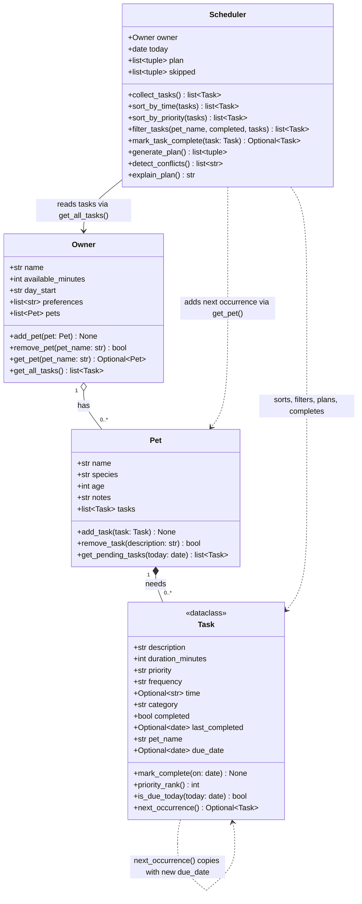

# 🐾 PawPal+

PawPal+ is a Streamlit app that helps a busy pet owner plan a day of pet care. You enter how much time you have, add your pets and their care tasks (walks, feeding, meds, grooming and so on), and PawPal+ builds a schedule. It picks the most important tasks that fit your time, puts each one at a start time, warns you about clashes, and explains every decision.

## ✨ Features

- **Multi-pet planning.** One owner can have several pets. The scheduler plans all of their tasks together, because the owner can only do one thing at a time.
- **Priority-based selection.** `Scheduler.generate_plan()` takes tasks from high to low priority and keeps each one that still fits in the minutes you have. Tasks that don't fit are listed as skipped, with the reason.
- **Preferred times and gap filling.** A task with a preferred time is placed at that time. Flexible tasks fill the open time before it, in priority order.
- **Sorting by time.** `Scheduler.sort_by_time()` lists tasks chronologically using `"HH:MM"` strings, with flexible tasks last. `Scheduler.sort_by_priority()` sorts high to low, breaking ties by time and then duration.
- **Filtering.** `Scheduler.filter_tasks()` shows one pet's tasks, only done or only not-done tasks, or both filters combined.
- **Daily and weekly recurrence.** `Scheduler.mark_task_complete()` marks a task done and adds the next copy to the same pet. A daily task's copy is due the next day and a weekly one's 7 days later, calculated with `timedelta`.
- **Conflict warnings.** `Scheduler.detect_conflicts()` flags tasks at the same time, or with overlapping time slots, for one pet or across pets. It returns warnings instead of raising errors, and the planner moves the later task to the next free slot.
- **Plan explanations.** Every scheduled task has a reason, such as "at preferred time 08:00", "fits before 08:00" or "preferred 08:15 but moved to avoid overlap". `Scheduler.explain_plan()` gives the whole plan as readable text.
- **Input validation.** Tasks reject a non-positive duration, an unknown priority or frequency, and an invalid time such as `25:00`. An owner can't have two pets with the same name.

## 🚀 Getting started

```bash
python -m venv .venv
source .venv/bin/activate        # Windows: .venv\Scripts\activate
pip install -r requirements.txt

streamlit run app.py             # the app, at http://localhost:8501
python main.py                   # the terminal demo
python -m pytest                 # the test suite
```

The app keeps your data in Streamlit's session state, so it lasts while the browser tab is open and resets when you reload the page.

## 📸 Demo Walkthrough

### What you can do in the app

The page has four sections, top to bottom.

1. **Owner.** Set your name, the minutes you have today, and when your day starts.
2. **Pets.** Add a pet with a name, species and age. The pets table shows how many tasks each one has.
3. **Tasks.**
   - Add a task for a pet with a description, category, duration, priority and frequency (daily, weekly or once). You can also tick **Set a preferred time** and choose a time.
   - Use **Mark a task complete** and **Complete** to finish a task. A green message confirms it, and for a recurring task it says when the next copy is due.
   - Use **Show pet**, **Status** and **Sort by** to filter the task table and sort it by time or priority. The **Status** column shows `due`, `done` or `next due <date>`.
   - When tasks clash, a yellow warning lists every conflict, explains that the later task will be moved, and suggests changing one task's time.
4. **Today's Schedule.** Press **Generate schedule**. You'll see:
   - totals for tasks planned, minutes used and tasks moved for conflicts
   - the schedule table, with a start time and a "Why" for each task
   - a green message if everything fits, or a yellow one listing the skipped tasks and the reason for each

### Example workflow

1. Set **Minutes available today** to 90 and **Day starts at** to 07:30.
2. Add two pets: Mochi (dog) and Luna (cat).
3. Add tasks:
   - Mochi: "Morning walk" (30 min, high, preferred 08:00) and "Breakfast" (10 min, high, flexible)
   - Luna: "Give meds" (5 min, high, preferred 08:15) and "Brush coat" (20 min, low, weekly)
4. A conflict warning appears right away, because the walk runs from 08:00 to 08:30 and the meds are set for 08:15.
5. Press **Generate schedule**:
   - Breakfast (07:30) and Brush coat (07:40) fill the open time before the walk.
   - The walk starts at 08:00 and the meds move to 08:30.
   - All 65 minutes of tasks fit in the 90 available, so nothing is skipped and "Moved for conflicts" shows 1.
6. Mark "Morning walk" complete. The message says the next daily copy is due tomorrow. Set **Status** to **Done** to see the finished walk, or **Not done** to see the new copy marked `next due`.
7. Generate the schedule again. The walk is gone from today's plan and the meds now run at 08:15.

### Scheduler behaviors in the demo

- **Sorting:** tasks are added out of order and `sort_by_time()` lists them by time, with flexible tasks last.
- **Filtering:** `filter_tasks(pet_name="Luna")` shows only Luna's tasks, and `filter_tasks(completed=True)` shows the finished ones.
- **Conflict warnings:** Luna's 08:00 breakfast clashes with Mochi's 08:00 walk ("both scheduled at"), and the walk also overlaps the 08:15 meds.
- **Conflict resolution:** the planner keeps the shorter breakfast at 08:00 and moves the walk and meds to the next free slots.
- **Time budget:** the low-priority weekly brushing is skipped because only 5 minutes are left.
- **Recurrence:** completing the daily walk and the weekly brushing creates copies due 1 and 7 days later.

### Sample CLI output

Output of `python main.py` (the dates depend on the day you run it):

```

All tasks, in the order they were added:
  09:30 Mochi  Puzzle toy     daily   pending
  08:00 Mochi  Morning walk   daily   pending
  flex  Mochi  Breakfast      daily   pending
  flex  Luna   Litter box     daily   pending
  08:15 Luna   Give meds      daily   pending
  flex  Luna   Brush coat     weekly  pending
  08:00 Luna   Breakfast      daily   pending

Sorted by time (flexible tasks last):
  08:00 Mochi  Morning walk   daily   pending
  08:00 Luna   Breakfast      daily   pending
  08:15 Luna   Give meds      daily   pending
  09:30 Mochi  Puzzle toy     daily   pending
  flex  Mochi  Breakfast      daily   pending
  flex  Luna   Litter box     daily   pending
  flex  Luna   Brush coat     weekly  pending

Filtered to Luna:
  flex  Luna   Litter box     daily   pending
  08:15 Luna   Give meds      daily   pending
  flex  Luna   Brush coat     weekly  pending
  08:00 Luna   Breakfast      daily   pending

Today's Schedule for Jordan
85 of 90 minutes planned, starting at 07:30
------------------------------------------------------------------------------
Time   Pet     Task             Min  Priority Why
------------------------------------------------------------------------------
07:30  Mochi   Breakfast         10  high     fits before 08:00
07:40  Luna    Litter box        10  medium   fits before 08:00
08:00  Luna    Breakfast          5  high     at preferred time 08:00
08:05  Mochi   Morning walk      30  high     preferred 08:00 but moved to avoid overlap
08:35  Luna    Give meds          5  high     preferred 08:15 but moved to avoid overlap
09:30  Mochi   Puzzle toy        25  medium   at preferred time 09:30
------------------------------------------------------------------------------
Skipped:
  - Brush coat (Luna): needs 20 min, only 5 min left
Conflicts:
  ! 'Morning walk' (Mochi) and 'Breakfast' (Luna) are both scheduled at 08:00
  ! 'Morning walk' (Mochi, 08:00, 30 min) overlaps 'Give meds' (Luna, 08:15)

Marked 'Morning walk' (daily) and 'Brush coat' (weekly) complete.

Completed tasks:
  08:00 Mochi  Morning walk   daily   done
  flex  Luna   Brush coat     weekly  done

Not yet completed (new copies are due later):
  09:30 Mochi  Puzzle toy     daily   pending
  flex  Mochi  Breakfast      daily   pending
  08:00 Mochi  Morning walk   daily   due 2026-11-12
  flex  Luna   Litter box     daily   pending
  08:15 Luna   Give meds      daily   pending
  08:00 Luna   Breakfast      daily   pending
  flex  Luna   Brush coat     weekly  due 2026-11-18
```

## 🏗️ Architecture

The logic lives in `pawpal_system.py`. `app.py` (Streamlit) and `main.py` (terminal) only call into it.

- **`Task`**: one care activity, with a duration, priority, frequency, an optional preferred time, a completion status and an optional due date. `is_due_today()` is true when the task isn't done and its due date has arrived. `next_occurrence()` makes the next copy of a recurring task.
- **`Pet`**: a pet's details and its tasks. `add_task()` tags each task with the pet's name.
- **`Owner`**: the time budget, day start and pets. `get_all_tasks()` returns every pet's tasks in one list.
- **`Scheduler`**: sorts, filters, plans, completes tasks and detects conflicts. It reads tasks only through `Owner.get_all_tasks()`.

The final class diagram is in [`diagrams/uml_final.mmd`](diagrams/uml_final.mmd), and the Phase 1 draft is in [`diagrams/uml.mmd`](diagrams/uml.mmd):



## 📐 Smarter Scheduling

These features live in `Scheduler` and `Task` in `pawpal_system.py`. `main.py` shows each one, and each has tests in `tests/test_pawpal.py`.

| Feature | Method(s) | What it does |
|---------|-----------|--------------|
| Sorting by time | `Scheduler.sort_by_time()` | Orders tasks by preferred `"HH:MM"` time, earliest first, with flexible (untimed) tasks last. |
| Sorting by priority | `Scheduler.sort_by_priority()` | Orders tasks high to low priority, then by time, then shortest first. `generate_plan()` uses it to decide what fits the time budget. |
| Filtering | `Scheduler.filter_tasks(pet_name=..., completed=...)` | Returns tasks for one pet, by completion status, or both. |
| Recurring tasks | `Scheduler.mark_task_complete()`, `Task.next_occurrence()` | Completing a daily or weekly task adds a new copy to the same pet, due 1 or 7 days after completion. |
| Conflict detection | `Scheduler.detect_conflicts()` | Warns when two due tasks share a start time or their time slots overlap, across all pets. |

**Sorting.** `sort_by_time()` calls `sorted()` with `key=lambda t: t.time or "99:99"`. Zero-padded `"HH:MM"` strings sort correctly as plain strings, and `Task` normalizes input such as `"8:00"` to `"08:00"` so this always holds. `"99:99"` sorts after every real time, which puts flexible tasks last.

**Filtering.** `filter_tasks()` takes an optional `pet_name` and an optional `completed` flag. A filter left as `None` is ignored, so `filter_tasks(pet_name="Luna", completed=False)` returns Luna's unfinished tasks.

**Recurring tasks.** `mark_task_complete(task)` marks the task done and calls `task.next_occurrence()`. For a recurring task, that returns a copy with `completed=False` and `due_date` set to the completion date plus `timedelta(days=1)` (daily) or `timedelta(weeks=1)` (weekly). The copy is added to the same pet. One-time tasks return `None`. Completing an already-completed task does nothing, so it can't create duplicates. `Task.is_due_today()` hides completed tasks and tasks whose due date hasn't arrived yet.

**Conflict detection.** `detect_conflicts()` sorts the due, timed tasks by start time and compares each task with the ones after it, stopping at the first one that starts after it ends. It returns warning strings and never raises. A shared start time reads "both scheduled at 08:00", and a partial overlap reads "overlaps". The checks cover all pets together, because the owner can't do two things at once. `generate_plan()` resolves conflicts by moving the later task to the next free slot. The warning tells the owner that a task won't happen at its preferred time.

## 🧪 Testing PawPal+

Run the tests from the project folder, with the virtual environment active:

```bash
python -m pytest            # run the full suite
python -m pytest --cov      # same, plus a coverage report
```

The suite is in `tests/test_pawpal.py` and has 42 tests. Each `Scheduler` in the tests gets a fixed date, so the results don't depend on the day you run them.

| Area | What the tests check |
|------|----------------------|
| Sorting | `sort_by_time()` returns tasks in chronological order, sorts `"8:00"` correctly as `08:00`, puts flexible tasks last, keeps insertion order for same-time tasks, and doesn't change the original list. `sort_by_priority()` breaks priority ties by time and then duration. |
| Filtering | `filter_tasks()` filters by pet, by completion status, or both. With no filters it returns every task, and with an unknown pet it returns an empty list. |
| Recurrence | Completing a daily task creates a new copy due the next day, and a weekly task's copy is due 7 days later. Dates roll over correctly at month ends, year ends and leap days. One-time tasks don't repeat, completing a task twice doesn't create duplicates, and overdue tasks stay due. |
| Conflict detection | Duplicate times are flagged for the same pet and across different pets. Partial overlaps are flagged, three same-time tasks produce all three pairs, back-to-back tasks are not conflicts, and completed tasks stop counting. |
| Plan generation | Timed tasks stay at their preferred time and flexible tasks fill the gaps. Overlapping tasks are moved so no two planned tasks run at once. Low-priority tasks are skipped when time runs out, a task that exactly fills the budget still fits, and completed or future tasks are left out. |
| Edge cases | An owner with no pets, a pet with no tasks, zero available minutes, invalid task values (they raise `ValueError`), duplicate pet names, and removing pets and tasks. |

Output of `python -m pytest`:

```
============================= test session starts ==============================
platform darwin -- Python 3.9.6, pytest-8.4.2, pluggy-1.6.0
rootdir: /Users/USER/Pawpal-AI-110
plugins: cov-7.1.0
collected 42 items

tests/test_pawpal.py ..........................................          [100%]

============================== 42 passed in 0.02s ==============================
```

The suite covers 100% of `pawpal_system.py` (`python -m pytest --cov`).

**Confidence level: ⭐⭐⭐⭐☆ (4/5)**

Every scheduling rule, including the edge cases above, has a passing test, and every line of the logic layer runs during the suite. I'm not giving it 5 stars for three reasons:
- The Streamlit UI isn't part of the automated suite. I only checked it by hand.
- A task that runs past midnight (for example 23:50 for 30 minutes) would get a start time like `24:20`. Nothing prevents or handles this yet.
- Picking tasks by priority is greedy, so it doesn't always fill the available time as fully as possible. This is a deliberate choice, explained in `reflection.md` section 2b.

## 📁 Project files

| File | What it is |
|------|------------|
| `pawpal_system.py` | Logic layer: `Task`, `Pet`, `Owner`, `Scheduler` |
| `app.py` | Streamlit UI |
| `main.py` | Terminal demo |
| `tests/test_pawpal.py` | Test suite (42 tests) |
| `diagrams/uml_final.mmd` | Final UML class diagram (Mermaid) |
| `reflection.md` | Design and AI-collaboration reflection |
